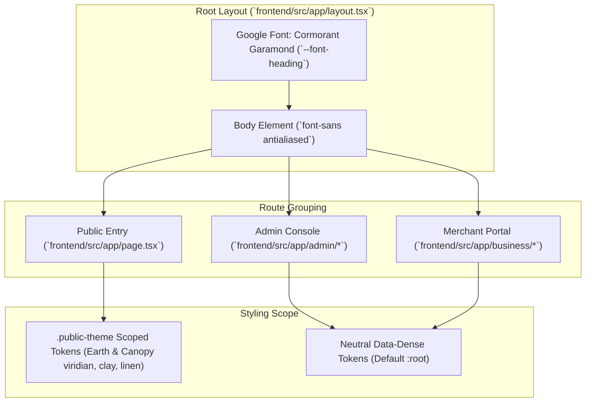

# Technical Design Document: Mangatarem Tourism Landing Page Editorial Redesign

* **Author:** jemhakdog
* **Date:** 2026-11-05
* **Status:** In Review (Drafting Phase)
* **Target Release:** v1.2-frontend

---

## 1. The Problem

The current Mangatarem tourism public landing page (`frontend/src/app/page.tsx`) relies on a standard software-as-a-service layout: vivid digital green gradients, floating generic cards, and uniform three-column grids. This presentation disconnects the digital experience from the tangible physical and historical identity of Mangatarem—the centuries-old Spanish colonial masonry of San Raymundo de Peñafort, the protected rainforest canopy of Manleluag Spring, and the sweeping mountain passes of Daang Kalikasan.

Beyond visual framing, three technical and usability deficiencies degrade the visitor experience:
1. **Excessive Network Payload on Rural Mobile Devices:** Attraction and event thumbnails are delivered through unoptimized HTML `` elements without responsive dimensioning or modern format negotiation (AVIF/WebP). On rural cellular connections in outer barangays (where users frequently connect on 3G or constrained 4G), this inflates page weight and pushes Largest Contentful Paint (LCP) past 3.5 seconds.
2. **Ambiguous Conversion Pathways:** First-time visitors arrive seeking either immediate geographic orientation (directions, travel times, nearby landmarks) or thematic cultural exploration (heritage architecture, eco-tourism, local festivals). The existing hero fails to offer direct, structured entry points into these two primary modes, requiring visitors to scroll through unstructured promotional cards.
3. **Severe Sunlight Glare Degradation:** Low-contrast typography and subtle gray metadata labels wash out completely under direct midday tropical sunlight, making operating hours and barangay locations illegible on budget mobile phone displays during field travel.

---

## 2. Overview

This design overhauls the public entry surface into a curated **editorial heritage journal**:
1. **Regional Visual Identity ("Earth & Canopy"):** Shifts from saturated generic greens to an authentic Pangasinan palette featuring deep canopy viridian, warm sun-baked terracotta clay, and aged bamboo linen. Critically, these tokens are encapsulated under `.public-theme` at the public layout root to prevent visual regressions in administrative (`/admin`) and business portal (`/business`) dashboards.
2. **Sunlight-Resilient Typography:** Activates an authoritative editorial serif display typeface (`Cormorant Garamond` or `Newsreader` via `next/font/google`) strictly for primary `h1` and `h2` headings, while keeping all UI metadata, badges, and card text in high-contrast sans-serif (`Geist Sans`/`Inter` with >=4.5:1 contrast ratio) for clear reading in direct outdoor glare.
3. **Sub-2.0s Rural Performance Budget:** Migrates all visual media to Next.js `Image` with AVIF/WebP format pipelines, defined responsive aspect ratios, static placeholder blur states, and whitelisted backend `remotePatterns` in `next.config.ts`.
4. **Immediate Spatial & Cultural Conversion:** Replaces passive promotional cards with twin above-the-fold conversion anchors: an interactive SVG vector preview routing to the interactive map (`/map`), and a quick-filter thematic bar routing to curated heritage archives (`/heritage`).

---

## 3. Goals & Non-Goals

### 3.1 In-Scope Goals
* **Sub-1.8s Mobile LCP:** Attain Largest Contentful Paint under 1.8 seconds and zero cumulative layout shift (CLS = 0) on simulated 4G mobile devices.
* **Scoped Earth & Canopy Design Tokens:** Declare OKLCH design variables scoped under `.public-theme` in `globals.css` representing canopy viridian, terracotta clay, and warm linen paper, keeping admin surfaces unaffected.
* **Sunlight-Readable Typography System:** Enforce a strict dual-font hierarchy: serif for editorial display headings (`h1`, `h2`), high-contrast sans-serif (>=4.5:1 contrast) for all navigation, badges, and metadata tags.
* **Modernized Next.js Image Pipeline:** Standardize `AttractionCard` and `EventCard` on `next/image` with explicit `aspect-[4/3]`, responsive `sizes`, backend `remotePatterns` in `next.config.ts`, and fallback SVG placeholders for offline resilience.
* **Dual Conversion Gateway:** Provide immediate direct access within the initial viewport to both geospatial exploration (`/map`) and cultural directory filtering (`/heritage`, `/attractions`).
* **Offline & Backend Cold-Start Resilience:** Guarantee functional rendering with statically embedded fallback records when the backend FastAPI service is unreachable or cold.

### 3.2 Out-of-Scope Non-Goals
* **Embedded WebGL Map on Landing Page:** The landing page will not render a live MapLibre WebGL canvas on initial load. Spatial exploration is offloaded entirely to `/map` to protect the 2.0s performance budget.
* **Booking & Commercial Checkout:** Commercial reservation, ticket checkout, and merchant payment flows remain outside scope; the platform operates strictly as an educational and cultural discovery guide.
* **Administrative & Merchant Portal Restyling:** Administrative consoles (`/admin`) and business owner portals (`/business`) retain their neutral data-dense styling and are untouched by this redesign.

---

## 4. Technical Plan

### 4.1 Architecture & Scope Encapsulation

To prevent visual regressions in administrative and merchant consoles, styling tokens are strictly partitioned. Global `:root` retains neutral system fallbacks, while the "Earth & Canopy" palette is scoped under `.public-theme`.



### 4.2 Scoped Design Tokens (`frontend/src/app/globals.css`)
In `globals.css`, `.public-theme` overrides semantic color tokens for public views:
* **Canopy Viridian (Primary):** `oklch(0.38 0.12 150)` (Light) / `oklch(0.55 0.14 150)` (Dark)
* **Terracotta Clay (Accent):** `oklch(0.62 0.16 48)` (Light) / `oklch(0.68 0.15 50)` (Dark)
* **Aged Linen Stone (Background):** `oklch(0.985 0.008 85)` (Light) / `oklch(0.16 0.02 155)` (Dark)
* **Muted Timber (Muted):** `oklch(0.94 0.012 85)` (Light) / `oklch(0.22 0.02 155)` (Dark)

### 4.3 Typography System (`frontend/src/app/layout.tsx`)
1. Import `Cormorant_Garamond` from `next/font/google` with weights `[500, 600, 700]` and `variable: "--font-heading"`, with `display: "swap"`.
2. Add `${cormorant.variable}` to `<body>` class list.
3. In `globals.css`, link `--font-heading` to `var(--font-heading)`.
4. Apply `font-heading font-medium tracking-tight` strictly to `h1` and `h2` headings on `page.tsx`.
5. Keep all metadata tags, timestamps, badges, and card captions in `font-sans` (`Poppins`) with a guaranteed contrast ratio exceeding 4.5:1 against card backgrounds.

### 4.4 Image Optimization Pipeline (`next.config.ts` & Component Updates)
1. **Next.js Config (`frontend/next.config.ts`):**
   ```typescript
   images: {
     formats: ['image/avif', 'image/webp'],
     remotePatterns: [
       { protocol: 'http', hostname: 'localhost' },
       { protocol: 'http', hostname: '127.0.0.1' },
       { protocol: 'https', hostname: '**.supabase.co' },
       { protocol: 'https', hostname: 'images.unsplash.com' },
     ],
   }
   ```
2. **AttractionCard & EventCard Modernization (`frontend/src/app/page.tsx`):**
   * Replace raw `` with `next/image`.
   * Enforce fixed aspect ratio containers (`aspect-[4/3]`) with `sizes="(max-width: 640px) 100vw, (max-width: 1024px) 50vw, 33vw"`.
   * Implement inline SVG vector fallbacks for null or unresolvable URLs, preventing broken image placeholders.
   * Apply `priority` attribute exclusively to the single primary hero cover asset.

### 4.5 Dual Conversion Gateway Component Design
Replace the current generic floating cards with a structured two-pillar conversion section placed directly under the editorial hero:
1. **Geospatial Anchor ("Explore Interactive Map"):**
   * Displays a stylized SVG vector silhouette of Mangatarem's 82 barangays.
   * Includes active counts (e.g., "15 Cultural Sites • 8 Natural Attractions").
   * Primary action button directs immediately to `/map`.
2. **Cultural Heritage Anchor ("Heritage & Living Traditions"):**
   * Features quick-navigation pills for primary cultural classifications:
     * *Spanish Colonial Heritage* (`/heritage/built-heritage`)
     * *Protected Landscapes & Springs* (`/heritage/natural-heritage`)
     * *Pangasinan Agricultural Traditions* (`/heritage/intangible-heritage`)
   * Secondary action button routes to `/attractions`.

### 4.6 Offline and Cold-Start Resilience
The server-rendered `getHome()` function in `frontend/src/app/page.tsx` maintains static fallback lists (`FALLBACK_EVENTS`, `FALLBACK_ATTRACTIONS`) cached with `revalidate: 60`. If the FastAPI backend is cold, uncommitted, or returning non-200 responses, the landing page hydrates gracefully without throwing Next.js 500 error boundaries.

---

## 5. Alternatives Considered

### 5.1 Alternative A: Full-Screen Interactive 3D / WebGL Hero
* **Concept:** Render a live MapLibre WebGL canvas directly inside the initial hero viewport with animated 3D terrain and floating interactive venue cards.
* **Rejected by author:** Exceeds 1.2MB in JavaScript bundle transfer, incurs a 30MB+ GPU/RAM footprint on initial load, triggers frequent mobile scroll-jacking during vertical browsing, and inflates mobile LCP beyond 4.5 seconds on rural 3G/4G connections. Live spatial tools belong behind explicit navigation routes (`/map`).

### 5.2 Alternative B: Utilitarian Search & Directory Hub
* **Concept:** Deploy a minimalist text search bar above a dense tabular catalog of barangays and registered cultural landmarks, devoid of editorial storytelling.
* **Rejected by author:** While achieving fast load times (<1.0s LCP), it completely discards Mangatarem's cultural narrative, lacks visual appeal, and presents like a municipal utility directory rather than a tourism destination portal.

### 5.3 Alternative C: Global Root CSS Token Overwrite
* **Concept:** Replace the primary `:root` variables in `frontend/src/app/globals.css` with the Earth & Canopy viridian and terracotta palette without creating a scoped `.public-theme` wrapper.
* **Rejected by author:** Introducing warm linen backgrounds and terracotta highlights globally caused immediate visual regressions in administrative (`/admin`) and business merchant (`/business`) dashboards, compromising table contrast, status indicator legibility, and form control clarity.

### 5.4 Alternative D: Comprehensive Multi-Page Redesign in Single Pass
* **Concept:** Redesign all public pages (`/attractions`, `/events`, `/heritage`, `/barangays`) simultaneously alongside the landing page.
* **Rejected by author:** Expanding the blast radius across 10+ sub-routes increases regression risk and delays shipping the critical public entry point. The landing page and shared design tokens establish the design system foundation first, allowing subsequent pages to adopt the pattern iteratively.

---

## 6. Detailed Implementation Plan

This section provides the complete, unambiguous execution blueprint. No impactful architectural decisions are deferred to implementation.

### 6.1 Enumeration of Affected Files

| File Path | Action | Rationale |
| :--- | :--- | :--- |
| `frontend/next.config.ts` | Modified | Configure Next.js Image formats (`AVIF`, `WebP`) and whitelist local/remote image host patterns to prevent image load exceptions. |
| `frontend/src/app/globals.css` | Modified | Define scoped `.public-theme` class overriding semantic color tokens with OKLCH Earth & Canopy values, leaving administrative dashboards unaffected. |
| `frontend/src/app/layout.tsx` | Modified | Load `Cormorant_Garamond` via `next/font/google`, inject `--font-heading` CSS variable onto body, and wrap public content in the `.public-theme` context. |
| `frontend/src/app/page.tsx` | Modified | Rebuild landing page UI: editorial hero section, dual spatial/cultural conversion gateway, modernized Next.js Image cards, and offline fallbacks. |
| `docs/designs/landing_page_editorial_redesign.md` | Finalized | Maintain canonical system design documentation aligned with repository standards. |
| `docs/designs/SITEMAP.md` | Modified | Register the completed technical design document in the project sitemap index. |

### 6.2 Step-by-Step Execution Sequence

#### Step 6.2.1: Image Optimization Configuration (`frontend/next.config.ts`)
* **Objective:** Enable AVIF and WebP image format negotiation and configure allowed image source domains.
* **Requirements:**
  * Add `images` property to `nextConfig`.
  * Set `formats: ['image/avif', 'image/webp']`.
  * Add `remotePatterns` entries for `http://localhost:*`, `http://127.0.0.1:*`, Supabase storage hosts (`https://**.supabase.co`), and Unsplash photography CDNs (`https://images.unsplash.com`).

#### Step 6.2.2: Scoped Design Tokens (`frontend/src/app/globals.css`)
* **Objective:** Define the Earth & Canopy visual tokens strictly scoped under `.public-theme`.
* **Requirements:**
  * In `frontend/src/app/globals.css`, declare `.public-theme`:
    * `--primary`: `oklch(0.38 0.12 150)` (Deep Canopy Viridian).
    * `--primary-foreground`: `oklch(0.99 0.005 85)` (Off-white linen).
    * `--accent`: `oklch(0.62 0.16 48)` (Terracotta Brick).
    * `--accent-foreground`: `oklch(0.99 0.005 85)`.
    * `--background`: `oklch(0.985 0.008 85)` (Aged Linen Stone).
    * `--foreground`: `oklch(0.18 0.02 160)` (Deep Charcoal Timber).
    * `--muted`: `oklch(0.94 0.012 85)`.
    * `--muted-foreground`: `oklch(0.42 0.03 150)`.
    * `--border`: `oklch(0.88 0.015 85)`.
  * Declare dark mode variant `.dark .public-theme`:
    * `--background`: `oklch(0.16 0.02 155)`.
    * `--foreground`: `oklch(0.96 0.008 85)`.
    * `--primary`: `oklch(0.55 0.14 150)`.
    * `--accent`: `oklch(0.68 0.15 50)`.
    * `--muted`: `oklch(0.22 0.02 155)`.
    * `--border`: `oklch(0.28 0.02 155)`.

#### Step 6.2.3: Editorial Typography Integration (`frontend/src/app/layout.tsx`)
* **Objective:** Activate high-contrast serif display typography without compromising UI metadata legibility.
* **Requirements:**
  * Import `Cormorant_Garamond` from `next/font/google` with weights `["500", "600", "700"]`, subsets `["latin"]`, and CSS variable `--font-heading`.
  * Append `cormorant.variable` to the `<body>` className.
  * Ensure `main#main-content` wraps page content in the `.public-theme` styling class.

#### Step 6.2.4: Landing Page Redesign (`frontend/src/app/page.tsx`)
* **Objective:** Rebuild `page.tsx` adhering to the editorial heritage journal pattern.
* **Requirements:**
  * **Hero Section:**
    * Replace saturated green gradient with an asymmetric, atmospheric header: deep canopy tones, subtle topographic vector texture, and high-contrast `h1` in `font-heading font-medium tracking-tight`.
    * Narrative subtitle highlighting San Raymundo de Peñafort, Manleluag Spring, and Daang Kalikasan.
    * Refined search input component (`HeroSearch`) with clear outdoor contrast.
  * **Dual Conversion Gateway:**
    * *Portal 1 (Interactive Spatial Discovery):* Stylized SVG map outline of Mangatarem with point-of-interest counters linking directly to `/map`.
    * *Portal 2 (Curated Cultural Archives):* Filter pills for Built Heritage, Natural Heritage, and Intangible Living Traditions linking to `/heritage` and `/attractions`.
  * **Media Cards Modernization (`AttractionCard` & `EventCard`):**
    * Replace `` elements with `next/image`.
    * Enforce strict `aspect-[4/3]` overflow-hidden containers with responsive `sizes` attribute.
    * Provide resilient inline SVG placeholder rendering for cards lacking images or failing network fetch.
    * Render metadata badges (category, barangay name, rating) strictly in `font-sans font-medium` with >=4.5:1 contrast against backgrounds.
  * **Seasonal Events & Announcements Cadence:**
    * Render curated events and municipal tourism notices with graceful local fallback arrays (`FALLBACK_EVENTS`) when the FastAPI backend is offline.

### 6.3 Verification & Quality Gate
1. **Visual Regression Check:** Verify that `/admin` and `/business` routes retain their baseline neutral styling and are unaffected by `.public-theme`.
2. **Performance Audit:** Verify through Chrome DevTools or Lighthouse that mobile LCP remains under 1.8 seconds on 4G throttle and CLS equals 0.
3. **Accessibility (WCAG 2.1 AA):** Verify color contrast on all text elements (minimum 4.5:1 for body and metadata, 3.0:1 for large display titles).
4. **Build & Lint Verification:** Execute `npm run build` and `npm run lint` in `frontend/` to confirm zero TypeScript compilation errors or ESLint violations.


