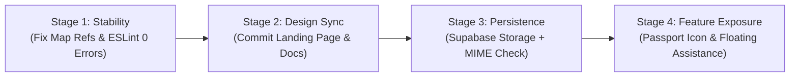

# Architectural Stabilization, Feature Exposure, and Design Finalization

* **Author:** jemhakdog
* **Date:** 2026-11-08
* **Status:** RFC (Published for Team Feedback)

## Overview

This brief establishes the definitive, Goldfish-evaluated roadmap resolving technical debt, runtime risks, and orphaned feature visibility across the Mangatarem Cultural Map and Tourism platform. The solution adopts an engineering-first, minimal-blast-radius approach:
1. Eliminates critical React 19 / ESLint compiler errors and resolves the serverless ephemeral file upload issue.
2. Commits and documents the already completed "Earth & Canopy" landing page editorial overhaul.
3. Integrates high-value orphaned capabilities (Digital Passport and Community Assistance) through dedicated UI patterns that avoid navbar clutter and serverless WebSocket breakdowns.

---

## Analysis & Goldfish Resolution Matrix

Across all six evaluation lenses, the following definitive decisions are adopted:

| Domain | Risk / Bottleneck Identified | Goldfish Evaluated Best Approach |
| :--- | :--- | :--- |
| **Real-Time Tourism Chat** | In-memory WebSockets break across multi-instance Vercel lambdas; 24/7 unstaffed concierge causes user frustration. | **Asynchronous Community & Assistance Widget:** Reposition chat as a floating concierge bubble backed by Supabase PostgreSQL persistence rather than in-memory process state. Avoid top navbar clutter. |
| **Digital Passport & Gamification** | Hidden behind `user.role === 'user'`; completely invisible to anonymous tourists and visitors. | **Header Icon Action + Guest Stamp Preview:** Expose `<BookOpen />` Passport icon button beside Search in the header. Provide a guest stamp preview modal prompting account creation to save stamps. |
| **Media Uploads** | Local `/uploads` directory is wiped on Vercel lambda container shutdown; file validation lacks MIME sniffing. | **Supabase Storage with MIME Validation:** Transition `backend/app/api/uploads.py` to Supabase Storage buckets with magic-byte validation and automatic fallback to local disk for offline development. |
| **React 19 & Code Quality** | `frontend/src/components/ui/map.tsx` mutates refs in render; admin pages trigger cascading state updates in effects (38 ESLint errors). | **Strict Hook Compliance:** Move ref mutations to `useEffect` lifecycle hooks in `map.tsx` and refactor admin effect dependencies to bring ESLint to 0 errors. Standardize on `frontend/package-lock.json`. |
| **Landing Page Editorial Redesign** | Completed code sits uncommitted in working tree while design documentation lists it as pending. | **Commit & Documentation Synchronization:** Run quality checks, commit the landing page overhaul, and update `docs/designs/landing_page_editorial_redesign.md` status to `Completed`. |
| **Commercial Booking Endpoints** | `backend/app/api/booking.py` contains commercial reservation code that conflicts with non-commercial guidelines. | **Preserve for Municipal Tour Capacity:** Keep booking logic decoupled from public discovery; repurpose later for municipal guided tour quotas or offload to future milestones. |

---

## Goals vs. Non-Goals

* **In-Scope Goals:**
  * **Stage 1 (Zero-Risk Stability):** Remediate mutable ref assignments in `frontend/src/components/ui/map.tsx` and cascading effect state setters in `frontend/src/app/admin/*` to achieve 0 ESLint errors. Standardize lockfile resolution.
  * **Stage 2 (Design Formalization):** Formally commit the landing page redesign files (`page.tsx`, `globals.css`, `layout.tsx`, `navbar.tsx`) and mark `docs/designs/landing_page_editorial_redesign.md` as `Completed`.
  * **Stage 3 (Persistent Upload Pipeline):** Implement Supabase Storage bucket uploads in `backend/app/api/uploads.py` with MIME validation and local filesystem fallback.
  * **Stage 4 (Navigation Wire-up):** Expose Digital Passport icon button with guest preview; embed floating Community Assistance widget.

* **Out-of-Scope Non-Goals:**
  * Building commercial payment checkouts or paid ticket processing.
  * Restyling `/admin` and `/business` consoles (they retain neutral data-dense layouts).
  * Major database schema re-architectures prior to Alembic scaffolding.

---

## Alternatives Weighed

* **Option A: Add Passport and Chat as Horizontal Header Links:**
  * *Rejected by Goldfish Review:* Overcrowds navbar to 10 horizontal items, triggering layout breaking and button overlapping on laptop and tablet screens.
* **Option B: Retain Local Uploads on Vercel with Cron Cleanup:**
  * *Rejected by Goldfish Review:* Incompatible with serverless execution. Vercel lambdas do not preserve `/uploads` across cold starts.
* **Option C: Stateful WebSocket Chat on Vercel Serverless:**
  * *Rejected by Goldfish Review:* In-memory WebSocket connections fail across distributed serverless functions.
* **Option D: Staged Phased Rollout (Selected):**
  * *Selected:* Fix zero-risk stability blockers first (P0), commit the existing landing page (P1), integrate non-intrusive navigation entry points (P1), and migrate uploads to Supabase Storage (P0/P2).

---

## Execution Staging Plan

1. **Stage 1: Stability (P0)**
   - Fix 3 ref mutations in `frontend/src/components/ui/map.tsx` (lines 1040, 1374, 1725).
   - Fix admin `useEffect` setState cascading renders.
   - Remove root lockfile dissonance.
   - Verify `npm run lint` and `npm run build` pass cleanly.
2. **Stage 2: Design Formalization (P1)**
   - Commit uncommitted landing page editorial redesign.
   - Update `docs/designs/landing_page_editorial_redesign.md` status to `Completed`.
   - Update `docs/designs/SITEMAP.md`.
3. **Stage 3: Persistent Upload Pipeline (P0)**
   - Update `backend/app/api/uploads.py` to support Supabase Storage bucket uploads.
   - Add MIME byte verification.
   - Retain local filesystem fallback for offline development.
4. **Stage 4: Feature Exposure & Guest UX (P1)**
   - Add `<BookOpen />` icon action button in `frontend/src/components/layout/navbar.tsx`.
   - Add guest preview state to `/passport`.
   - Add floating assistance launcher for tourist inquiries.
