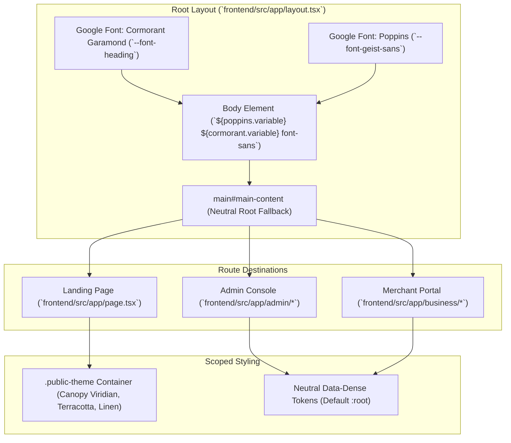

# Technical Design Document: Mangatarem Tourism Landing Page Editorial Redesign

* **Author:** jemhakdog
* **Date:** 2026-11-05
* **Status:** Finalized (Ready for Implementation)
* **Target Release:** v1.2-frontend

---

## 1. Problem Statement

The current Mangatarem tourism public landing page ([`frontend/src/app/page.tsx`](file:///home/jem/Projects/Interactive-Digital-Cultural-Map-and-Local-Tourism-Information-system-for-Mangatarem--Pangasinan/frontend/src/app/page.tsx)) relies on a generic SaaS layout: vivid green gradients, floating card components, and uniform three-column grids. This presentation disconnects the digital experience from Mangatarem's municipal cultural heritage—the Spanish colonial masonry of San Raymundo de Peñafort, the rainforest canopy of Manleluag Spring, and the mountain corridors of Daang Kalikasan.

Three technical and usability factors degrade the visitor experience:
1. **Excessive Network Payload on Rural Mobile Devices:** Attraction and event thumbnails are delivered through unoptimized HTML `` elements without responsive dimensioning or modern format negotiation (AVIF/WebP). On rural cellular connections in outer barangays (connecting via 3G or constrained 4G), this inflates page weight and pushes Largest Contentful Paint (LCP) past 3.5 seconds.
2. **Ambiguous Conversion Pathways:** First-time visitors arrive seeking either immediate geographic orientation (directions, travel times, nearby landmarks) or thematic cultural exploration (heritage architecture, eco-tourism, local festivals). The existing hero fails to offer direct, structured entry points into these two primary modes, requiring visitors to scroll through unstructured promotional cards.
3. **Outdoor Sunlight Glare Degradation:** Low-contrast typography and subtle gray metadata labels (contrast ratios below 4.5:1) wash out under direct outdoor sunlight, reducing legibility on budget mobile displays during travel.

---

## 2. Overview

This design overhauls the public entry surface into a curated editorial heritage journal:
1. **Regional Visual Identity ("Earth & Canopy"):** Shifts from saturated digital greens to an earth palette featuring deep canopy viridian (`oklch(0.38 0.12 150)`), terracotta clay (`oklch(0.62 0.16 48)`), and aged linen stone (`oklch(0.985 0.008 85)`). These tokens are encapsulated under `.public-theme` at the root of [`frontend/src/app/page.tsx`](file:///home/jem/Projects/Interactive-Digital-Cultural-Map-and-Local-Tourism-Information-system-for-Mangatarem--Pangasinan/frontend/src/app/page.tsx) to prevent visual regressions in administrative (`/admin`) and business portal (`/business`) dashboards.
2. **Sunlight-Resilient Typography:** Activates a serif display typeface (`Cormorant Garamond` via `next/font/google`) strictly for primary `h1` and `h2` headings, while keeping all UI metadata, badges, and body text in high-contrast sans-serif (`font-sans` / `Poppins` with >=4.5:1 contrast ratio) for outdoor reading legibility.
3. **Sub-1.8s Rural Performance Budget:** Migrates all visual media to Next.js `Image` with AVIF/WebP format pipelines, defined responsive aspect ratios, static fallback states, and allowlisted backend `remotePatterns` in [`frontend/next.config.ts`](file:///home/jem/Projects/Interactive-Digital-Cultural-Map-and-Local-Tourism-Information-system-for-Mangatarem--Pangasinan/frontend/next.config.ts).
4. **Immediate Spatial & Cultural Conversion:** Replaces passive promotional cards with twin above-the-fold conversion anchors: an interactive SVG vector preview routing to the interactive map (`/map`), and a quick-filter thematic bar routing to curated heritage archives (`/heritage`).

---

## 3. Goals & Non-Goals

### 3.1 In-Scope Goals
* **Sub-1.8s Mobile LCP:** Attain Largest Contentful Paint under 1.8 seconds and cumulative layout shift (CLS < 0.1, targeting < 0.05) on simulated 4G mobile devices.
* **Scoped Earth & Canopy Design Tokens:** Declare OKLCH design variables scoped under `.public-theme` in [`frontend/src/app/globals.css`](file:///home/jem/Projects/Interactive-Digital-Cultural-Map-and-Local-Tourism-Information-system-for-Mangatarem--Pangasinan/frontend/src/app/globals.css) representing canopy viridian, terracotta clay, and warm linen paper, keeping admin surfaces unaffected.
* **Sunlight-Readable Typography System:** Enforce a strict dual-font hierarchy: serif for editorial display headlines (`h1`, `h2`), high-contrast sans-serif (>=4.5:1 contrast) for all navigation, badges, and metadata tags.
* **Modernized Next.js Image Pipeline:** Standardize `AttractionCard` and `EventCard` on `next/image` with explicit `aspect-[4/3]`, responsive `sizes`, backend `remotePatterns` in [`frontend/next.config.ts`](file:///home/jem/Projects/Interactive-Digital-Cultural-Map-and-Local-Tourism-Information-system-for-Mangatarem--Pangasinan/frontend/next.config.ts), and fallback SVG placeholders for offline resilience.
* **Dual Conversion Gateway:** Provide immediate direct access within the initial viewport to both geospatial exploration (`/map`) and cultural directory filtering (`/heritage`, `/attractions`).
* **Offline & Backend Cold-Start Resilience:** Provide static fallback records when the backend FastAPI service is unreachable or cold.

### 3.2 Out-of-Scope Non-Goals
* **Embedded WebGL Map on Landing Page:** The landing page will not render a live MapLibre WebGL canvas on initial load. Spatial exploration is offloaded entirely to `/map` to protect the 1.8s performance budget.
* **Booking & Commercial Checkout:** Commercial reservation, ticket checkout, and merchant payment flows remain outside scope; the platform operates strictly as an educational and cultural discovery guide.
* **Administrative & Merchant Portal Restyling:** Administrative consoles (`/admin`) and business owner portals (`/business`) retain their neutral data-dense styling and are untouched by this redesign.

---

## 4. Proposed Architecture

### 4.1 Architecture & Scope Encapsulation

To prevent visual regressions in administrative and merchant consoles, styling tokens are strictly partitioned. Global `:root` retains neutral system fallbacks, while the "Earth & Canopy" palette is scoped under `.public-theme`. Root [`frontend/src/app/layout.tsx`](file:///home/jem/Projects/Interactive-Digital-Cultural-Map-and-Local-Tourism-Information-system-for-Mangatarem--Pangasinan/frontend/src/app/layout.tsx) remains neutral without `.public-theme` on `main#main-content`, and `.public-theme` is applied directly to the top-level container in [`frontend/src/app/page.tsx`](file:///home/jem/Projects/Interactive-Digital-Cultural-Map-and-Local-Tourism-Information-system-for-Mangatarem--Pangasinan/frontend/src/app/page.tsx).



### 4.2 Scoped Design Tokens ([`frontend/src/app/globals.css`](file:///home/jem/Projects/Interactive-Digital-Cultural-Map-and-Local-Tourism-Information-system-for-Mangatarem--Pangasinan/frontend/src/app/globals.css))

In `globals.css`, `.public-theme` overrides semantic color tokens for public views:
* **Canopy Viridian (Primary):** `oklch(0.38 0.12 150)` (Light) / `oklch(0.55 0.14 150)` (Dark)
* **Terracotta Clay (Accent):** `oklch(0.62 0.16 48)` (Light) / `oklch(0.68 0.15 50)` (Dark)
* **Aged Linen Stone (Background):** `oklch(0.985 0.008 85)` (Light) / `oklch(0.16 0.02 155)` (Dark)
* **Muted Timber (Muted):** `oklch(0.94 0.012 85)` (Light) / `oklch(0.22 0.02 155)` (Dark)

### 4.3 Typography System ([`frontend/src/app/layout.tsx`](file:///home/jem/Projects/Interactive-Digital-Cultural-Map-and-Local-Tourism-Information-system-for-Mangatarem--Pangasinan/frontend/src/app/layout.tsx))

1. Import `Cormorant_Garamond` from `next/font/google` with weights `["500", "600", "700"]`, subsets `["latin"]`, `display: "swap"`, and variable `"--font-heading"`.
2. Append `cormorant.variable` to the `<body>` className alongside `poppins.variable` and `geistMono.variable`.
3. In `globals.css`, `@theme inline` already maps `--font-heading: var(--font-heading);` and `--font-sans: var(--font-geist-sans);`.
4. Apply `font-heading font-medium tracking-tight` strictly to `h1` and `h2` headings on `page.tsx`.
5. Keep all metadata tags, timestamps, badges, and card captions in `font-sans` (`Poppins`) with contrast exceeding 4.5:1 against backgrounds.

### 4.4 Image Optimization Pipeline ([`frontend/next.config.ts`](file:///home/jem/Projects/Interactive-Digital-Cultural-Map-and-Local-Tourism-Information-system-for-Mangatarem--Pangasinan/frontend/next.config.ts))

1. **Next.js Config Configuration:**
   ```typescript
   images: {
     formats: ["image/avif", "image/webp"],
     remotePatterns: [
       { protocol: "http", hostname: "localhost", port: "8000" },
       { protocol: "http", hostname: "127.0.0.1", port: "8000" },
       { protocol: "https", hostname: "*.supabase.co" },
       { protocol: "https", hostname: "images.unsplash.com" },
     ],
   },
   ```
2. **AttractionCard & EventCard Modernization ([`frontend/src/app/page.tsx`](file:///home/jem/Projects/Interactive-Digital-Cultural-Map-and-Local-Tourism-Information-system-for-Mangatarem--Pangasinan/frontend/src/app/page.tsx)):**
   * Replace raw `` with `next/image`.
   * Enforce fixed aspect ratio containers (`aspect-[4/3]`) with `sizes="(max-width: 640px) 100vw, (max-width: 1024px) 50vw, 33vw"`.
   * Cards remain Server Components: render `next/image` when `item.image_url` is non-empty; if `item.image_url` is missing or null, fall back to `resolvePlaceImage(item.name)` or an inline SVG vector icon.
   * Apply `priority` attribute exclusively to the single primary hero cover asset.

### 4.5 Dual Conversion Gateway Component Design

Replace the current generic floating cards with a structured two-pillar conversion section placed directly under the editorial hero:
1. **Geospatial Anchor ("Explore Interactive Map"):**
   * Displays an inline SVG vector silhouette of Mangatarem's boundary outline.
   * Includes active counts: "15 Cultural Sites • 8 Natural Attractions".
   * Primary action button directs immediately to `/map`.
2. **Cultural Heritage Anchor ("Heritage & Living Traditions"):**
   * Quick-navigation pills for primary cultural classifications:
     * *Spanish Colonial Heritage* (`/heritage?type=built-heritage`)
     * *Protected Landscapes & Springs* (`/heritage?type=natural-heritage`)
     * *Pangasinan Agricultural Traditions* (`/heritage?type=intangible-heritage`)
   * Secondary action button routes to `/attractions`.

### 4.6 Offline and Cold-Start Resilience

The server-rendered `getHome()` function in [`frontend/src/app/page.tsx`](file:///home/jem/Projects/Interactive-Digital-Cultural-Map-and-Local-Tourism-Information-system-for-Mangatarem--Pangasinan/frontend/src/app/page.tsx) wraps backend calls in a `try/catch` block with `{ next: { revalidate: 60 } }`. If the FastAPI backend is cold, network-disconnected, or returns a non-200 response, `getHome()` catches the error and returns `{ featured_attractions: [], featured_events: [] }`, prompting `page.tsx` to render static fallback datasets (`FALLBACK_EVENTS` and `CURATED_ATTRACTION_METADATA`) without throwing Next.js 500 error boundaries.

---

## 5. Risks & Limits

1. **Remote Image Transformation Resource Limits:** Generating real-time AVIF formats on a Node.js server under traffic bursts can cause CPU spikes. Mitigated by allowing only verified remote origins (`*.supabase.co`, `images.unsplash.com`), setting `minimumCacheTTL: 86400`, and relying on standard WebP as secondary fallback.
2. **External CDN Downtime:** If third-party image hosts fail, client browsers receive 404/504 errors on image requests. Mitigated by wrapping cards in `aspect-[4/3]` background containers with muted background color and static SVG fallbacks.
3. **Typography Loading (FOUC):** Loading Google Fonts over rural connections can trigger a flash of unstyled text. Mitigated by setting `display: "swap"` on `Cormorant_Garamond` and pairing it with system serif fallbacks (`ui-serif, Georgia, serif`).
4. **Data Freshness vs. Cold Start Resilience:** Statically cached fallbacks (`revalidate: 60`) may briefly serve outdated metadata during backend deployments. Mitigated by keeping fallback datasets limited to verified historical landmarks and annual festivals that change infrequently.

---

## 6. Alternatives Considered

### 6.1 Alternative A: Full-Screen Interactive 3D / WebGL Hero
* **Concept:** Render a live MapLibre WebGL canvas directly inside the initial hero viewport with animated 3D terrain and floating interactive venue cards.
* **Rejected:** Exceeds 1.2MB in JavaScript bundle transfer, incurs a 30MB+ GPU/RAM footprint on initial load, triggers mobile scroll-jacking during vertical browsing, and inflates mobile LCP beyond 4.5 seconds on rural connections. Interactive spatial tools belong behind dedicated navigation routes (`/map`).

### 6.2 Alternative B: Utilitarian Search & Directory Hub
* **Concept:** Deploy a minimalist text search bar above a dense tabular catalog of barangays and registered cultural landmarks, devoid of editorial storytelling.
* **Rejected:** While achieving fast load times (<1.0s LCP), it discards cultural heritage identity, lacks visual engagement, and functions like an administrative directory rather than a tourism destination guide.

### 6.3 Alternative C: Global Root CSS Token Overwrite
* **Concept:** Replace the primary `:root` variables in [`frontend/src/app/globals.css`](file:///home/jem/Projects/Interactive-Digital-Cultural-Map-and-Local-Tourism-Information-system-for-Mangatarem--Pangasinan/frontend/src/app/globals.css) with the Earth & Canopy palette without creating a scoped `.public-theme` wrapper.
* **Rejected:** Replacing global `:root` variables caused immediate visual regressions in administrative (`/admin`) and business merchant (`/business`) dashboards, compromising table contrast, status badges (`--badge-muted`), and data filter controls.

### 6.4 Alternative D: Comprehensive Multi-Page Redesign in Single Pass
* **Concept:** Redesign all public pages (`/attractions`, `/events`, `/heritage`, `/barangays`) simultaneously alongside the landing page.
* **Rejected:** Expanding the blast radius across 10+ sub-routes increases regression risk and delays shipping the public entry point. The landing page and shared design tokens establish the design system foundation first, allowing subsequent pages to adopt the pattern iteratively.

---

## 7. Detailed Implementation Plan

This section details file modifications, implementation sequencing, and verification checks for the landing page redesign.

### 7.1 Enumeration of Affected Files

| File Path | Action | Rationale |
| :--- | :--- | :--- |
| `frontend/next.config.ts` | Modify | Configure Next.js Image formats (`AVIF`, `WebP`) and allowlist remote image host patterns to prevent image load exceptions while preserving `allowedDevOrigins`. |
| `frontend/src/app/globals.css` | Modify | Define scoped `.public-theme` class overriding semantic color tokens with OKLCH Earth & Canopy values, leaving administrative dashboards unaffected. |
| `frontend/src/app/layout.tsx` | Modify | Load `Cormorant_Garamond` via `next/font/google`, inject `--font-heading` CSS variable onto body, keeping `main#main-content` neutral. |
| `frontend/src/app/page.tsx` | Modify | Rebuild landing page UI wrapped in `.public-theme`: editorial hero section, dual spatial/cultural conversion gateway, modernized Next.js Image cards, and offline fallbacks. |
| `docs/designs/landing_page_editorial_redesign.md` | Modify | Maintain canonical system design documentation aligned with repository standards. |
| `docs/designs/SITEMAP.md` | Modify | Register the completed technical design document in the project sitemap index. |

### 7.2 Step-by-Step Execution Sequence

#### Step 7.2.1: Image Optimization Configuration (`frontend/next.config.ts`)
* **Objective:** Enable AVIF and WebP image format negotiation and configure allowed image source domains.
* **Implementation:**
  In `frontend/next.config.ts`, add the `images` configuration block to `nextConfig`:
  ```typescript
  images: {
    formats: ["image/avif", "image/webp"],
    remotePatterns: [
      { protocol: "http", hostname: "localhost", port: "8000" },
      { protocol: "http", hostname: "127.0.0.1", port: "8000" },
      { protocol: "https", hostname: "*.supabase.co" },
      { protocol: "https", hostname: "images.unsplash.com" },
    ],
  },
  ```

#### Step 7.2.2: Scoped Design Tokens (`frontend/src/app/globals.css`)
* **Objective:** Define the Earth & Canopy visual tokens strictly scoped under `.public-theme`.
* **Implementation:**
  In `frontend/src/app/globals.css`, declare `.public-theme`:
  ```css
  .public-theme {
    --primary: oklch(0.38 0.12 150);
    --primary-foreground: oklch(0.99 0.005 85);
    --accent: oklch(0.62 0.16 48);
    --accent-foreground: oklch(0.99 0.005 85);
    --background: oklch(0.985 0.008 85);
    --foreground: oklch(0.18 0.02 160);
    --muted: oklch(0.94 0.012 85);
    --muted-foreground: oklch(0.42 0.03 150);
    --border: oklch(0.88 0.015 85);
  }

  .dark .public-theme {
    --background: oklch(0.16 0.02 155);
    --foreground: oklch(0.96 0.008 85);
    --primary: oklch(0.55 0.14 150);
    --accent: oklch(0.68 0.15 50);
    --muted: oklch(0.22 0.02 155);
    --border: oklch(0.28 0.02 155);
  }
  ```

#### Step 7.2.3: Editorial Typography Integration (`frontend/src/app/layout.tsx`)
* **Objective:** Activate serif display typography without compromising UI metadata legibility or leaking styles to admin routes.
* **Implementation:**
  1. Import `Cormorant_Garamond` in `frontend/src/app/layout.tsx`:
     ```tsx
     import { Cormorant_Garamond, Poppins, Geist_Mono } from "next/font/google";

     const cormorant = Cormorant_Garamond({
       variable: "--font-heading",
       subsets: ["latin"],
       weight: ["500", "600", "700"],
       display: "swap",
     });
     ```
  2. Append `${cormorant.variable}` into `<body className="...">` alongside `${poppins.variable} ${geistMono.variable}`.
  3. Keep `<main id="main-content">` clean and neutral without adding `.public-theme`.

#### Step 7.2.4: Landing Page Redesign (`frontend/src/app/page.tsx`)
* **Objective:** Rebuild `page.tsx` adhering to the editorial heritage journal pattern.
* **Implementation:**
  1. Wrap `page.tsx` root in `<div className="public-theme min-h-screen bg-background text-foreground">`.
  2. **Hero Section:**
     * Render container with `bg-background text-foreground border-b border-border/60`.
     * `h1` styled with `font-heading font-medium tracking-tight text-4xl sm:text-5xl lg:text-6xl text-foreground`.
     * Narrative subtitle: `"Discover the centuries-old Spanish masonry of San Raymundo de Peñafort, the protected rainforest canopy of Manleluag Spring, and the scenic mountain corridors of Daang Kalikasan."`
     * Render `HeroSearch` (`@/components/public/hero-search`) with high-contrast inputs meeting WCAG AA >= 4.5:1.
  3. **Dual Conversion Gateway:**
     * *Section 1 (Interactive Map Portal):* Navigation card linking to `/map` with inline SVG boundary outline of Mangatarem and stat badges: `15 Cultural Sites` and `8 Natural Attractions`.
     * *Section 2 (Cultural Heritage Portal):* Navigation card linking to `/heritage` with filter pills:
       - Built Heritage: `/heritage?type=built-heritage`
       - Natural Heritage: `/heritage?type=natural-heritage`
       - Living Traditions: `/heritage?type=intangible-heritage`
  4. **Media Cards (`AttractionCard` & `EventCard`):**
     * Replace `` elements with `next/image` using `fill` inside fixed `aspect-[4/3] relative overflow-hidden rounded-xl bg-muted`.
     * Render `next/image` when `item.image_url` is present; fall back to `resolvePlaceImage(item.name)` or an inline SVG placeholder if missing.
     * Render metadata badges (category, barangay) in `font-sans font-medium` with >= 4.5:1 contrast against card backgrounds.
  5. **Seasonal Events & Announcements:**
     * Render curated events and municipal tourism notices with static fallback array (`FALLBACK_EVENTS`) when the FastAPI backend is offline.

### 7.3 Verification & Quality Gate
1. **Visual Regression Check:** Verify that `/admin` and `/business` routes retain their baseline neutral styling and are unaffected by `.public-theme`.
2. **Performance Audit:** Verify through Chrome DevTools or Lighthouse that mobile LCP remains under 1.8 seconds on 4G throttle and CLS < 0.1 (target < 0.05).
3. **Accessibility (WCAG 2.1 AA):** Verify color contrast on all text elements (minimum 4.5:1 for body and metadata, 3.0:1 for large display titles).
4. **Automated Unit & Build Verification:**
   - Execute `npm test` in `frontend/` to confirm fallback data rendering.
   - Execute `npm run build` and `npm run lint` in `frontend/` to confirm zero TypeScript compilation errors or ESLint violations.
